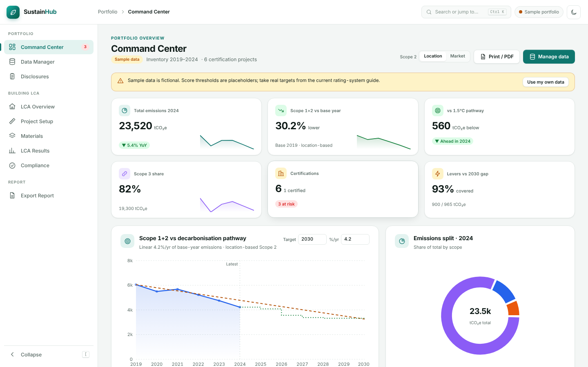

# SustainHub

One workspace for a sustainability consultant's core numbers: **GHG inventory, decarbonisation pathway, certification portfolio, reporting disclosures and building LCA**. It runs in the browser and needs no backend. Data stays on your machine.



## What's inside

| Area | What it does |
|---|---|
| **Clients** | Separate workspace per client (switcher in the header). **Client sharing** builds a read-only, single-file dashboard per client with only the sections, disclosure frameworks and certification projects you tick; activity data and factor libraries never leave your workspace. See [docs/HOSTING.md](docs/HOSTING.md). |
| **Documentation** | Your IGBC narrative templates (from the IGBC Narrative Builder): 6 rating systems, 271 credits. Open the filled calculation workbook to fill every figure from its named ranges; type project facts in place; per-credit status, owner and due date; Copy for Word. |
| **Live client portal** | A private claude.ai page per client that updates in real time when you import an update from Client sharing, with a two-way "documents we need from you" board. See [docs/HOSTING.md](docs/HOSTING.md). |
| **Workspace** | First-run choice: carbon only, or add certifications and/or building LCA. Switch modules on or off any time; hidden modules disappear from the navigation, the dashboard and the Excel export. |
| **Carbon Calculator** | Standalone Scope 1, 2 and 3 calculator: activity data by site with data-quality tags × emission factors from **bundled official packs**: CEA CO₂ Baseline Database v22.0 (India grid FY 2013-14 to 2025-26), UK DESNZ 2025 and 2026 (all kg CO₂e rows), GHG Protocol GWPs (AR5/AR6), plus import of any other official file (US EPA, IPCC…). Every factor keeps dataset, edition and row reference; editing a value removes its "official" tag. Totals go to the inventory with one click. |
| **Decarbonisation Strategy** | SBTi-style near-term and net-zero targets (editable), trajectory to net zero, gap by scope, hotspot analysis with a 27-measure library (each linked to the relevant LEED credit), a Now / Next / Later roadmap, residual-emission planning and an auto-written strategy summary. |
| **Command Center** | KPIs with sparklines, Scope 1+2 against a linear 1.5 °C-aligned pathway with a "with dated levers" projection, scope split, inventory trend, Scope 3 hotspots by GHG Protocol category, MACC, intensity trends (per m², per FTE, per turnover), LEED category scorecard, certification pipeline with a "needs attention" list, and the full portfolio table. Location/market Scope 2 toggle. |
| **Data Manager** | Validated editors for inventory years (Scope 2 dual reporting, 15 Scope 3 categories, intensity denominators), certification projects (LEED, IGBC, GRIHA, EDGE, WELL, Fitwel; category scorecards with a LEED v4/v4.1 BD+C template), levers (delivery year, cost per tonne), reporting settings and workspace modules. |
| **Disclosures** | Report-ready tables for **GHG Protocol, GRI 305, BRSR Principle 6 and IFRS S2**, with previous-year comparatives and an Available / Partial / Missing status on every line. Copy any table straight into Excel or Word. |
| **Exports** | Formatted multi-sheet **Excel workbook** (Summary, Inventory, Scope 3, Intensity, Disclosures, Strategy, Certifications, Levers, Factors with provenance, Activities by site), CSVs, JSON backup/restore, print-to-PDF styles. |
| **Building LCA** | Material inventory against EPD data, EN 15978 stages A–D, LEED v4/v4.1 MRc1, BREEAM Mat 01 and ISO 14044 checks. The A1–A3 result can be added to Scope 3 Category 2 (capital goods) with one click. |

Plus: dark mode, a collapsible sidebar (`[`), a **Ctrl/⌘ + K** command palette, skeleton loading, empty states on every panel, a mobile layout, and reduced-motion support.

## Host it

Merge PR #1 into the default branch (`claude/lca-analysis-tool-CQfCB`), then set **Settings → Pages → Source: GitHub Actions**. The app goes live at https://siddhant1497.github.io/lca-tool/ and redeploys on every merge. Details and client-sharing options are in [docs/HOSTING.md](docs/HOSTING.md).

## Run it

```bash
npm install
npm run dev        # http://localhost:3000
npm test           # 48 unit tests: pathway, strategy, factor packs, sharing, narratives, workbook reader, portal
npm run build      # production build in dist/
```

## Method notes

- **Pathway.** Linear absolute contraction of base-year Scope 1+2, by default 4.2 %/yr (the SBTi 1.5 °C rate for Scope 1+2). The rate and target year are editable. The base year is the earliest inventory year.
- **Gap coverage.** Only levers that are **not yet implemented** count against the remaining gap, because implemented ones are already in the actuals. The projection line steps down in each lever's delivery year, and levers without a year are listed rather than guessed.
- **MACC.** Open levers with a cost, cheapest first. Bar width is tCO₂e/yr and height is cost per tonne, with negative values for net savings.
- **Scope 2.** Location- and market-based figures are stored separately. Years without a market-based figure are flagged when you switch to market-based, rather than silently mixed.
- **Intensity.** Scope 1+2 per m² (kgCO₂e), per FTE and per turnover. BRSR's per-rupee figure appears when turnover is in a ₹ unit.
- **Emission factors.** Bundled packs were read from the publishers' documents (CEA v22.0 Annexure-I; DESNZ 2025/2026 flat files; GHG Protocol GWP table v2.0) and keep edition plus table/row references. Nothing is used until you pick and import rows. AR5 blend GWPs computed from the GHG Protocol table reproduce DESNZ's refrigerant factors exactly (unit-tested).
- **Strategy defaults.** 4.2 %/yr Scope 1+2 (1.5 °C), 2.5 %/yr Scope 3 (well-below 2 °C) and a ≥ 90 % cut by the net-zero year follow SBTi criteria; check them against the current criteria version. Residual emissions are neutralised with removals; offsets are never counted as reductions.

## Honest limits

- The sample portfolio is fictional, and its certification thresholds are placeholders.
- Disclosure references map your data to each framework; check them against the version you report under. This is not an assurance review.
- Data is stored in browser `localStorage`, so use **Export & backup → Download backup** regularly.

See [`docs/COMMAND_CENTER.md`](docs/COMMAND_CENTER.md) for the design notes and roadmap.
